# FPS_Project

A first-person shooter prototype built solo in **Unreal Engine 5.0** with **C++**. The goal of the project is not the content but the code: component-based architecture, data-driven design, asynchronous loading and clean ownership of objects.

> **Status:** playable prototype, actively refactored. A lot of code was changed in one large pass (encapsulation, polymorphism, async loading, pooling, state handling). Some older places were not touched yet and may still contain raw pointers, public fields or leftover code. See [Known issues](#known-issues).

<!-- Drag your best 10-20 second clip here in GitHub's web editor. It uploads the file and inserts a link. -->

## Contents

- [Features](#features)
- [Demo](#demo)
- [Architecture](#architecture)
- [What changed in the refactor](#what-changed-in-the-refactor)
- [Weapons and animation-driven logic](#weapons-and-animation-driven-logic)
- [Systems](#systems)
- [Class diagrams](#class-diagrams)
- [Known issues](#known-issues)
- [Roadmap](#roadmap)
- [Getting started](#getting-started)

## Features

- **Weapons:** several guns (M4, M1911, Mossberg 590, BREN2, Honey Badger) on one polymorphic base class, attachments (sight, grip, stock, laser), recoil, spread, reload types (magazine and shell by shell), pooled shell casings.
- **First-person view model:** spring-based sway, jump and movement offsets, aiming down sights aligned to the sight's aim socket, left-hand IK with an animation curve weight.
- **Inventory:** slots, stacking, drop, items built from data assets and fragments.
- **Interaction:** tap to pick up, hold to grab a physics object, throw, examine items.
- **Object examination:** inspect an item in a separate studio scene with camera blending, rotation and zoom.
- **Construction:** ghost preview, grid snapping, ground and overlap checks, placement.
- **Movement:** sprint with stamina, crouch with a stand-up check, state-driven field of view.
- **UI:** widget stack subsystem (menus, inventory, options), data-driven and loaded asynchronously.

### Weapons/Weapon Manager

<!-- drag weapons clip here -->

### Weapon Attachment

<!-- drag weapons clip here -->

### Weapon/View Model Animations

<!-- drag weapons clip here -->

### Inventory

<!-- drag inventory clip here -->

### Interaction

<!-- drag inventory clip here -->

### Examination

https://github.com/user-attachments/assets/5779bf79-846d-4a3f-bc3e-ad7fe40e5141

### Construction

https://github.com/user-attachments/assets/499b257f-7ace-45a5-bc55-0f8ae230cd61

## Architecture

The character is a **composition root**: it creates the components and wires them together with delegates. Each component owns one feature. The player controller only translates input into calls. Gameplay classes never depend on widgets; UI talks to gameplay through delegates and a context object.

```
AFPSPlayerController  (input only: Enhanced Input, mapping contexts)
        |  calls
        v
AFPSCharacter  (composition root, wires delegates in BeginPlay)
   |-- UFPSStateComponent        single source of truth for character state (FStateList)
   |-- UCrouchComponent / USprintComponent / UStaminaComponent
   |-- UFieldOfViewComponent     reacts to state changes
   |-- UWeaponManager            weapons, equip/holster/reload state machine
   |      '-- AWeaponBase (+ 5 weapons)  -- UWeaponAttachmentComponent, AWeapon_Casing pool
   |-- UViewModelComponent       arms, springs, ADS, montage playback, anim notify entry point
   |-- URecoilComponent
   |-- UInventoryComponent       slots, items, fragments
   |-- UInteractionComponent / UHandleGrabComponent
   |-- UExaminationComponent  -> AExamineStudio
   '-- UConstructionComponent

ULocalUIManager, ULocalGlobalSettings  (LocalPlayer subsystems)
UFPSAnimInstance                       (reads data through interfaces)
```

Communication rules:

- **Down:** owners call methods of the components they own.
- **Up and sideways:** components announce things with multicast delegates (`OnShoot`, `OnWeaponLoaded`, `OnStatesChanged`, `OnInventorySlotSelected`, ...). The character subscribes and connects the right listeners, so components do not know each other.
- **Across module borders:** interfaces (`IWeaponIKProvider`, `ICharacterStateProvider`, `IInteractableInterface`, `IExaminatableInterface`).

Signal flow of the whole game, as drawn in the diagrams:

1. Input &rarr; controller &rarr; component method (`TryShoot`, `ToggleCrouch`, `EndInteraction`, ...).
2. Component changes its own data and broadcasts a delegate.
3. The character wired the delegate to another component, which reacts.
4. Animation notifies report back to the code when something has happened in a montage (see below).

## What changed in the refactor

### Encapsulation
- Fields moved to `private`/`protected`; the outside world uses small getters and `Try*` methods that validate before they act (`TrySetWeaponState` returns `false` if the transition is not allowed).
- Pointers to other objects are `TWeakObjectPtr` when the object is not owned, `TObjectPtr` with `UPROPERTY` when it is. No raw `UObject*` members that the garbage collector cannot see.
- `Instanced` fragments and data assets keep data out of code.

### Polymorphism
- `AWeaponBase` defines the contract (`Shoot`, `Reload`, ammo, cooldown, spread); concrete weapons override what differs. `UWeaponManager` works only with the base class.
- Interfaces replace casts to concrete classes: the interaction component works with anything that implements `IInteractableInterface`; the AnimInstance reads IK and view-model state through `IWeaponIKProvider` and `ICharacterStateProvider`.
- Item behaviour is composed from `UItemFragment` objects (`FindFragment<T>`) instead of an inheritance tree of item types.

### Dynamic (asynchronous) loading
- Weapons, widgets, build data, ghost meshes and the examination studio are **soft references** (`TSoftClassPtr`, `TSoftObjectPtr`) loaded with `FStreamableManager::RequestAsyncLoad` only when needed.
- **Stale-load guards:** request ids (`PendingActivations`), `CurrentIndexToLoad`, `CurrentClassToLoad` and `bActive` discard results that arrive after the player has already moved on.
- Lambdas capture `TWeakObjectPtr` so a destroyed owner is never touched.
- Naming: `LoadXAsync` starts a load, `OnXLoaded` is the completion, `HandleXChanged` reacts to a delegate.
- Widgets flagged `bPreload` are loaded at start to avoid a hitch on first open; `bActivateOnLoaded` shows a widget as soon as it is ready.

### Architecture
- State is a single `FStateList` in `UFPSStateComponent`. Sprint, crouch, weapons, field of view and the animation blueprint read or react to it instead of keeping duplicated booleans.
- UI is a **LocalPlayer subsystem** with a widget stack, layers and one action delegate. Widgets receive a `Context` object, so neither side needs a hard dependency on the other.
- Everything tunable lives in data assets (`UWeaponData`, `UItemDefinition`, `UUIData`, `UBuildLibraryData`, `UBuildObjectData`, `UCharacterStatsDataAsset`).

### Optimization
- **Object pooling** for shell casings: spawned once, activated and returned instead of spawn/destroy per shot.
- **Tick on demand:** `UCrouchComponent`, `UFieldOfViewComponent`, `URecoilComponent`, `UViewModelComponent` and weapons enable their tick only while they have work and switch it off afterwards.
- **Events instead of polling:** state, ammo, stamina and inventory changes are broadcast only when a value really changed.
- Async loading keeps hitches out of the game thread; the ghost mesh and weapons never block the frame.

## Weapons and animation-driven logic

The weapon flow is driven by the animations, not by timers. A montage contains **AnimNotifies** that fire at an exact stage of the animation and tell the code what happened. The code then decides what to do next.

```
Montage frame reached
  -> UAnimNotify_*            (placed on the montage by the animator)
  -> UViewModelComponent      (entry point: HandleMontageFinished / HandleWeaponAnimEvent / HandleWeaponCasingEvent)
  -> OnMontageFinished        (delegate, wired by the character)
  -> UWeaponManager::HandleMontageFinished(EWeaponAnimStage)
  -> next action: charge, insert next shell, become Ready, activate the next weapon ...
```

| Notify | Fires at | What the code does next |
|---|---|---|
| `AnimNotify_WeaponAnimStage` (`EWeaponAnimStage`) | end of a stage (shoot, reload start/end, charge, insert ammo, stock) | `UWeaponManager` advances its state machine |
| `AnimNotify_HolsterFinished` | end of holster | previous weapon is hidden, the pending weapon is activated and its equip montage starts |
| `AnimNotify_EquipFinished` | end of equip | state becomes `Ready`, the weapon can shoot |
| `AnimNotify_WeaponEvent` (`EWeaponAnimEvent`) | a frame inside a montage (mag out, mag in, clatch, charge back, ...) | weapon plays the matching sound at that frame |
| `AnimNotify_SpawnCasing` | the frame where the shell leaves the weapon | a casing is taken from the pool and ejected |

Example, shell-by-shell reload: `Reload_Start` montage &rarr; `ReloadStartFinished` &rarr; manager checks the magazine and plays `InsertAmmo` &rarr; `InsertAmmoFinished` adds one round and repeats until the magazine is full or reserve ammo ends &rarr; `Reload_Finish` &rarr; charge if needed &rarr; `Ready`.

Because logic follows the animation, changing the length of a montage does not break the code.

## Systems

### Weapons (UWeaponManager)
The manager works only with AWeaponBase; concrete weapons (M4, M1911, Mossberg 590, BREN2, Honey Badger) override the behaviour that differs.
A weapon class is a soft reference. LoadWeaponAsync() spawns it at once if it is already in memory, otherwise it requests an async load with a weak pointer to the manager, so a destroyed manager is never touched.
After loading, the weapon is spawned hidden, attached to the arms socket from its data asset and reported through OnWeaponLoaded (slot index + actor). The inventory stores the actor in the slot.
The manager is a state machine: Ready, Holstering, Equipping, Reloading, Charging, Stocking. The state is mirrored to UFPSStateComponent, so sprint, field of view and animation react to it.
Swapping: holster montage → HolsterFinished → the old weapon is hidden and the new one is activated on the next tick → equip montage → EquipFinished → Ready.
TryShoot() and TryReload() are guarded: the weapon must exist, the state must be Ready, the player must not be sprinting, and a reload also needs CanReload(). The weapon decides if the shot is possible and the manager broadcasts OnShoot with the recoil value.
Reload types come from the weapon data: a normal magazine reload, or shell by shell (Reload_Start → InsertAmmo loop → Reload_Finish). Every next step is chosen in HandleMontageFinished(EWeaponAnimStage) when an animation notify reports the stage.

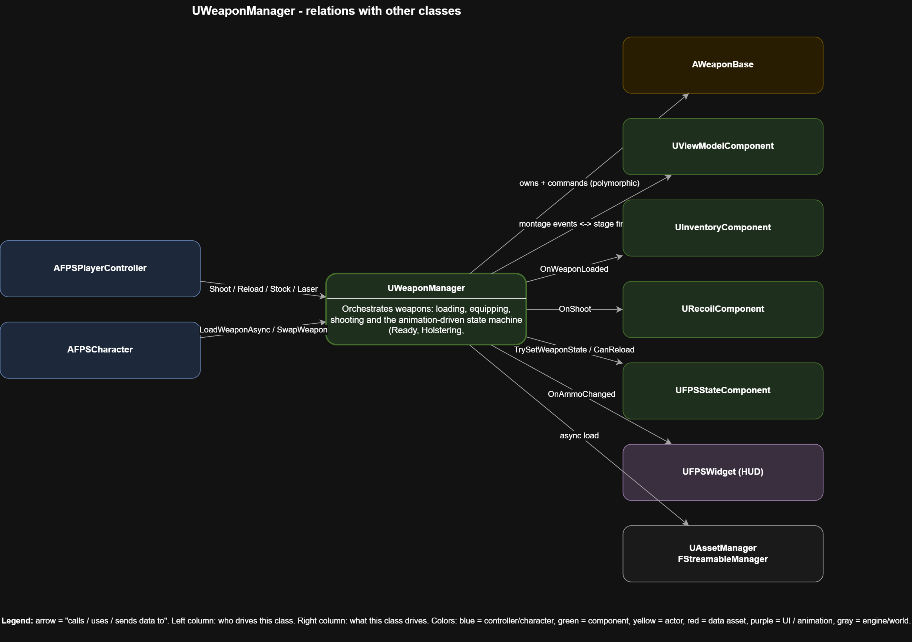
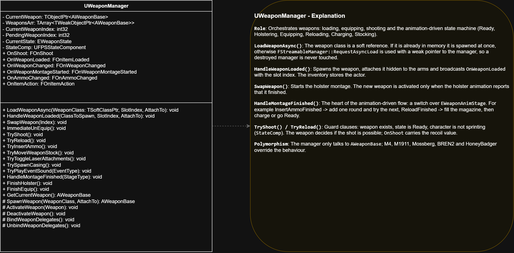

### Weapon attachments (UWeaponAttachmentComponent)
Every weapon owns one attachment component. Attachments are described by UAttachmentData (type, mesh or actor class, target socket, stat modifiers, state) and listed in CurrentAttachments, so a weapon is configured in the editor without code.
Initialize() runs on BeginPlay and spawns what each entry needs: a static mesh component for visual parts (sight, grip, stock) or an actor for parts with behaviour (laser). Both are attached to a socket of the weapon mesh.
GetTotalModifiers() combines all attachments: additive damage, multiplicative recoil, spread and ADS spread. The weapon applies the result once when it is initialized.
The stock has two states (Extended / Folded). After the stock animation finishes, the weapon recalculates its spread from the attachment modifiers.
The grip exposes the S_HandGrip socket, which is the target of the left-hand IK. The sight exposes SOCKET_AimPoint, which the view model uses to align the camera when aiming.
The laser implements IAttachmentInterface, so the component toggles it without knowing the concrete class.
Attachments are hidden and shown together with the weapon.


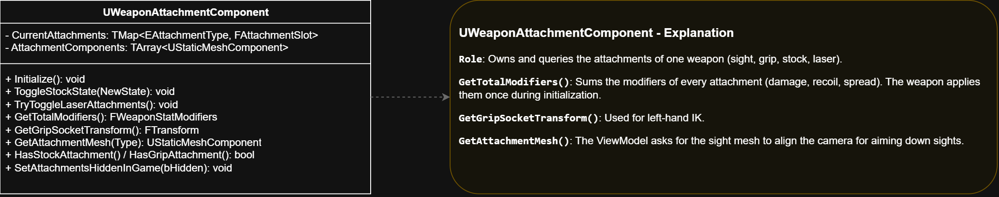

### UI (ULocalUIManager)
A ULocalPlayerSubsystem: one manager per player that owns the widget stack, layers and input mode.
Widgets are described in a data asset (UUIData, a list of FWidgetData: soft widget class, layer, UI type, bPreload, bActivateOnLoaded). Adding a menu does not require changing the manager.
FindAndPushWidget(Type, Context, OnReady) loads the widget asynchronously. Every request gets an id in PendingActivations; if the player asks for the same widget again before it is loaded, the older result is dropped (stale-load guard).
Context is a UObject given to widgets that implement IUIContextReceiver (for example the inventory component for the inventory menu), so a widget gets its data without a hard dependency in either direction.
Layers decide the Z-order. Pushing a modal widget removes old context menus, the game HUD stays hit-test invisible, and the HUD is hidden while the examination screen is open.
ApplyInputMode() switches between game-only input and game-and-UI input (cursor, ignored look input) depending on whether a focusable widget is on the stack.
All buttons report through one interface and one handler. Navigation (Play, Options, Back, Quit, Discard) is handled inside the manager. Gameplay actions (Drop, Delete, Save) are rebroadcast with the context through OnGameplayActionRequest, and the character decides what to do.
Widgets flagged bPreload are loaded when the UI data is set, so the first open has no hitch.

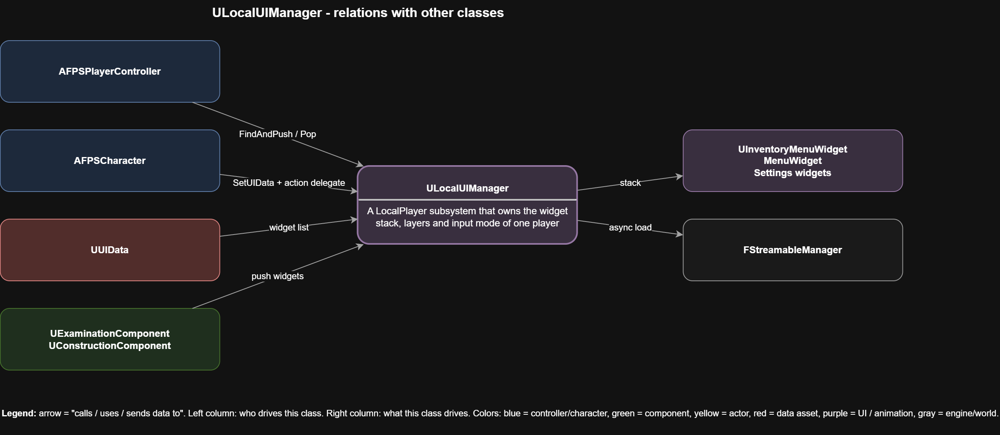
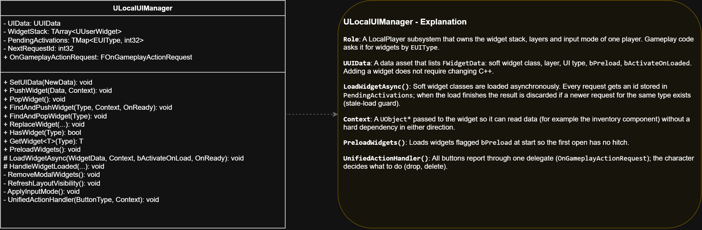

### View model (UViewModelComponent)
Everything the first-person arms and weapon need visually lives here, not in the character or in the animation blueprint.
Springs: sway from mouse input, vertical offset from jump or fall velocity, and sideways and forward offset from local movement velocity. Targets are clamped, reduced while aiming (AimPenaltyValue) and smoothed with a critically damped FloatSpringInterp (stiffness, damping, mass are editable).
The results are collected into FViewModelState and handed to the animation blueprint through ICharacterStateProvider.
Aiming: UpdateADS() reads the sight's SOCKET_AimPoint and the camera socket on the arms and interpolates the camera to the sight when the state component says the player is aiming.
Montages: on a weapon event it plays the matching montage on the arms and on the weapon from the maps in UWeaponData. When the weapon changes it links the weapon's animation layers to the arms (LinkAnimClassLayers) or hides the arms and stops montages if nothing is equipped.
Animation entry point: AnimNotifies find this component on the character and call HandleMontageFinished, HandleWeaponAnimEvent or HandleWeaponCasingEvent. The component re-broadcasts them, and UWeaponManager decides the next action.
The tick is enabled only while a weapon is equipped.

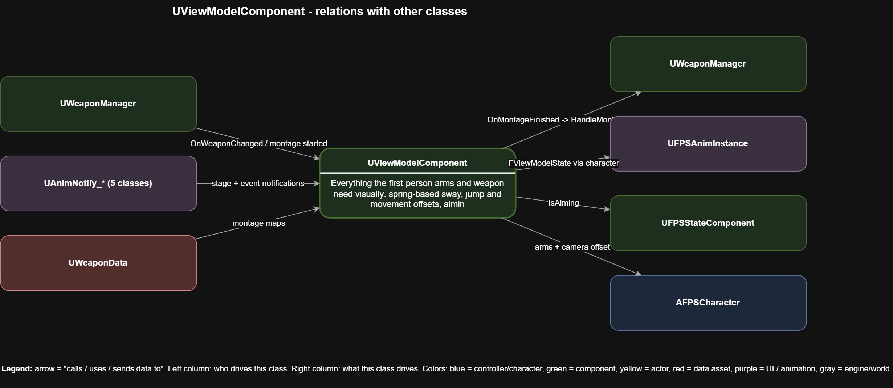
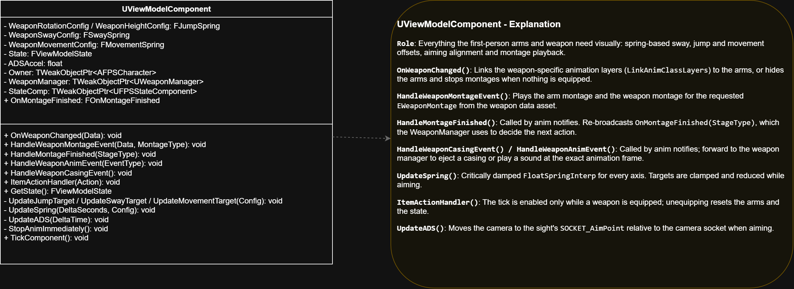

### Animation instance (UFPSAnimInstance)
The animation blueprint reads ready-made data from this class instead of querying gameplay classes.
Every frame on the game thread it copies the FStateList from the state component, the FViewModelState and the weapon IK data from the owner.
The owner is accessed only through interfaces: IWeaponIKProvider gives the IK data and ICharacterStateProvider gives the view-model state, so the anim instance does not include the character class.
Left-hand IK is updated in the thread-safe update. The target alpha is the IK alpha multiplied by the LeftHandIKWeight curve of the playing montage, so animators can switch IK off during a reload. Alpha is interpolated, and location and rotation (slerp) follow the grip target only while alpha is above zero.

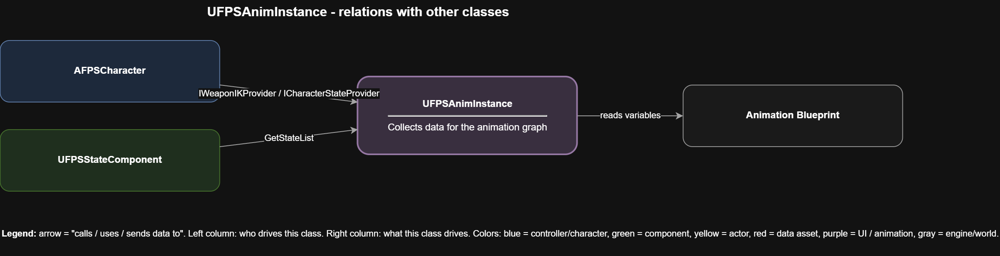
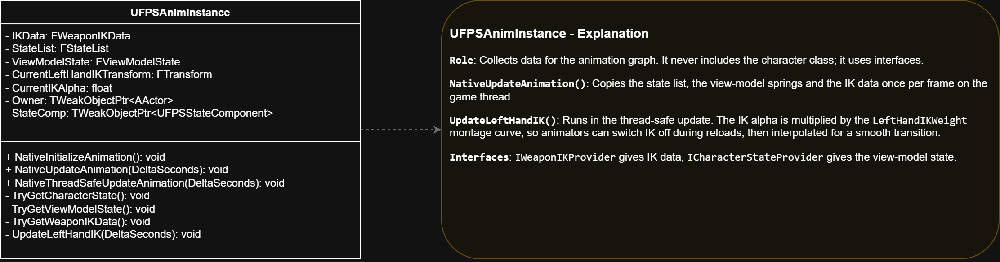

### Inventory (UInventoryComponent, UItemDefinition)
The inventory is a data model. It stores slots (ItemDef, Quantity, ItemType, ActionMap, SpawnedActor) and announces changes with delegates. It does not know about widgets or weapons.
AddItem() stacks into existing slots up to MaxStackSize, then fills an empty slot and broadcasts OnItemAdded.
Items are data assets (UItemDefinition): icon and world class as soft references, stack size, the button map for the item's menu, and a list of Instanced fragments. FindFragment<T>() looks up behaviour by capability, for example the weapon fragment holds the soft weapon class.
Weapon flow: OnItemAdded → the character finds the weapon fragment → UWeaponManager::LoadWeaponAsync → OnWeaponLoaded → RegisterActorInSlot stores the spawned actor in the slot.
Selecting a slot broadcasts OnInventorySlotSelected with the stored actor and the item type; the character routes weapons to SwapWeapon.
Dropping removes one item and broadcasts OnInventorySlotDropped; the character spawns an APickUpActor in front of the camera (deferred spawn, so the item data is set before construction) and throws it.
ClearSlot() broadcasts OnInventorySlotCleared before destroying the spawned actor, so the character can unequip a weapon that is being removed.
The inventory widget receives the component as its context. Drop and Delete come back through ULocalUIManager::OnGameplayActionRequest with the slot index.

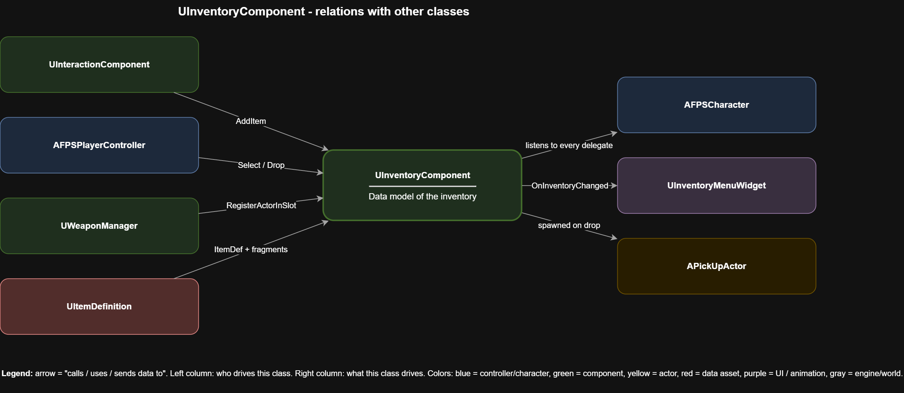
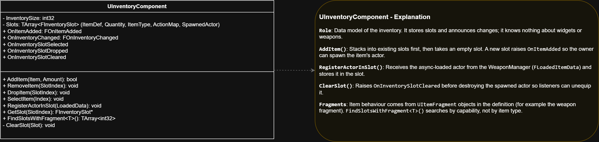

### Interaction (UInteractionComponent, UHandleGrabComponent)
One key, two actions. EndInteraction(ElapsedTime) is called on key release: a tap shorter than 0.2 s releases anything held and tries to pick up, a longer hold grabs a physics object.
The trace starts at GetActorEyesViewPoint(), which the character overrides to return the camera, so the ray always goes where the player looks.
The component never knows concrete item classes. A hit actor is used through IInteractableInterface (Interact, GetPrimitiveOnInteract) or IExaminatableInterface (GetExaminationItem).
Picking up is done by the item: APickUpActor::Interact finds the interactor's UInventoryComponent, calls AddItem and destroys itself only if the item fit.
UHandleGrabComponent uses a Physics Handle. While an object is held, every tick moves the handle target to camera location + camera forward * MaxGrabDistance. Throwing releases the object and applies an impulse along the camera direction.
Examination uses the same trace. TryExamineItem starts or stops UExaminationComponent and reports the result to the controller, which switches the mapping context.

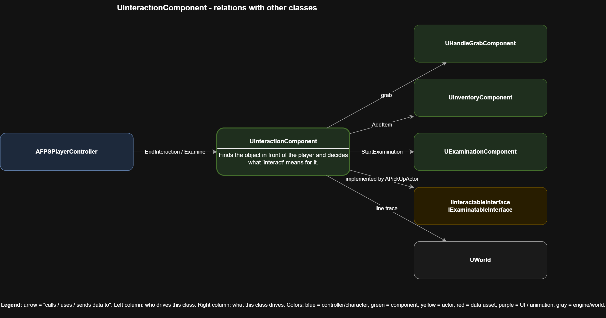
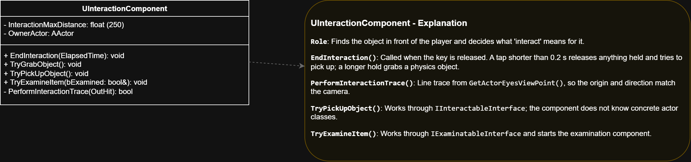

### Examination
- `UExaminationComponent` remembers the current view target, blends to the studio, locks look/move input, requests the item and pushes the widget. Exiting reverses everything.
- `AExamineStudio` is spawned far from the level so it never overlaps level geometry. It owns the camera and an anchor; rotation is applied to the anchor, not to the item.
- Item data (`FExamineItem`) defines the item class (soft reference) and the camera distances.

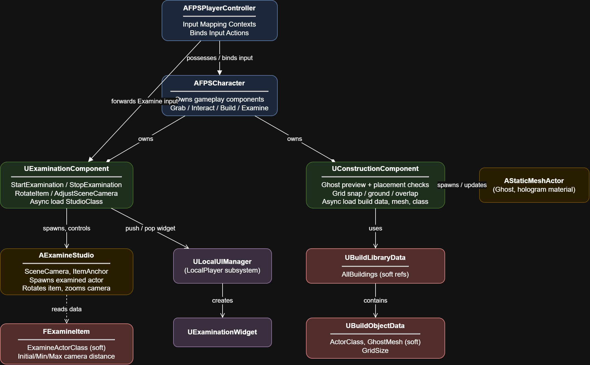


### Construction
1. Build mode adds a mapping context and enables the component's tick.
2. Selecting a building async-loads its data; stale loads are discarded by `CurrentIndexToLoad`.
3. Every tick the aim point is snapped to the building's grid; the ghost updates only when the snapped point changes.
4. The ghost mesh loads asynchronously and stays hidden until ready.
5. Validation: ground trace, depth limit, alignment, overlap test.
6. Ghost is green when placement is valid, red when not.
7. Placing spawns the real actor (loading its class on demand) and re-validates the spot.

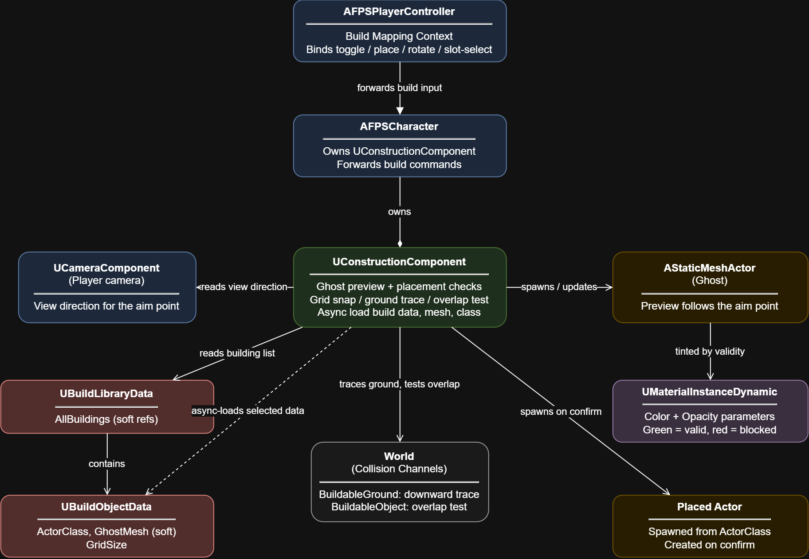
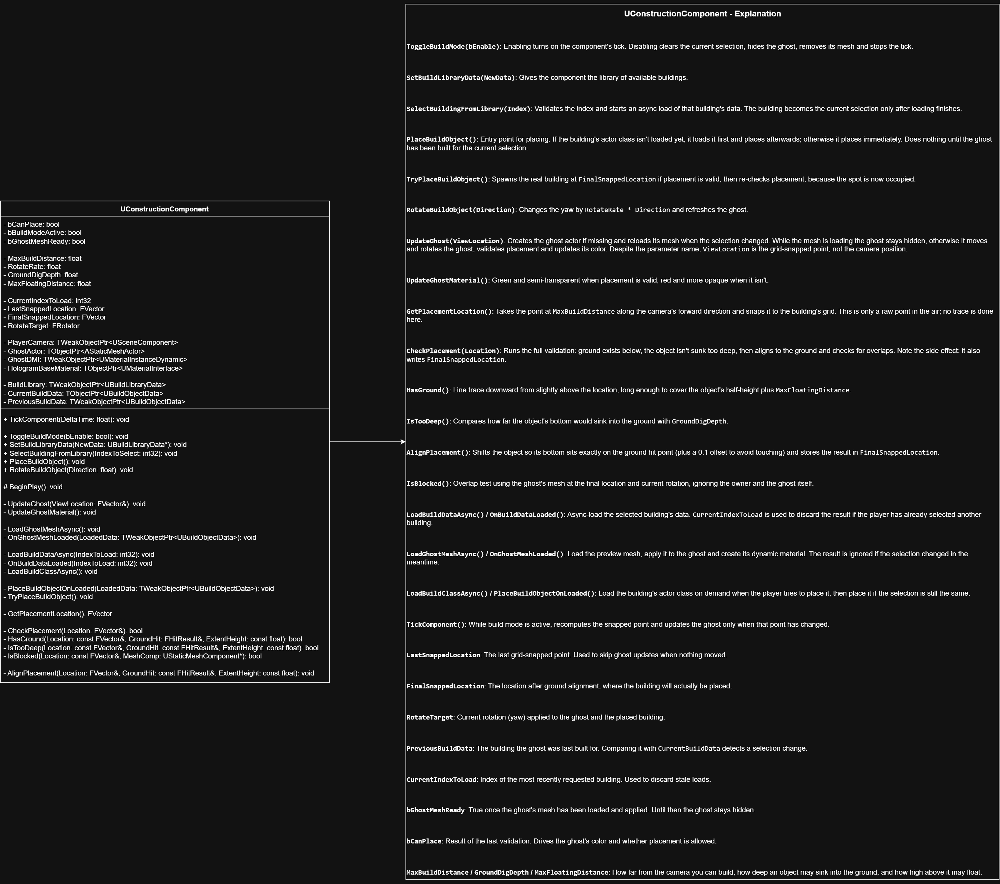

## Class diagrams

Every important class has two diagrams in [`docs/diagrams`](docs/diagrams) (editable in [draw.io](https://app.diagrams.net/)):

- `<class>_system` - everything inside the class: fields, methods and an explanation of each.
- `<class>_behavior` - how the class is connected to other classes: who drives it and what it drives.

| Area | Class | Contents | Relations |
|---|---|---|---|
| Core | `AFPSCharacter` | [system](docs/diagrams/fps_character_system.drawio) | [behavior](docs/diagrams/fps_character_behavior.drawio) |
| Core | `AFPSPlayerController` | [system](docs/diagrams/fps_player_controller_system.drawio) | [behavior](docs/diagrams/fps_player_controller_behavior.drawio) |
| State and movement | `UFPSStateComponent` | [system](docs/diagrams/fps_state_component_system.drawio) | [behavior](docs/diagrams/fps_state_component_behavior.drawio) |
| State and movement | `UCrouchComponent` | [system](docs/diagrams/crouch_component_system.drawio) | [behavior](docs/diagrams/crouch_component_behavior.drawio) |
| State and movement | `USprintComponent` | [system](docs/diagrams/sprint_component_system.drawio) | [behavior](docs/diagrams/sprint_component_behavior.drawio) |
| State and movement | `UStaminaComponent` | [system](docs/diagrams/stamina_component_system.drawio) | [behavior](docs/diagrams/stamina_component_behavior.drawio) |
| State and movement | `UFieldOfViewComponent` | [system](docs/diagrams/field_of_view_component_system.drawio) | [behavior](docs/diagrams/field_of_view_component_behavior.drawio) |
| Weapons | `UWeaponManager` | [system](docs/diagrams/weapon_manager_system.drawio) | [behavior](docs/diagrams/weapon_manager_behavior.drawio) |
| Weapons | `AWeaponBase` | [system](docs/diagrams/weapon_base_system.drawio) | [behavior](docs/diagrams/weapon_base_behavior.drawio) |
| Weapons | `AWeapon_Casing` | [system](docs/diagrams/weapon_casing_system.drawio) | [behavior](docs/diagrams/weapon_casing_behavior.drawio) |
| Weapons | `UWeaponAttachmentComponent` | [system](docs/diagrams/weapon_attachment_component_system.drawio) | [behavior](docs/diagrams/weapon_attachment_component_behavior.drawio) |
| Weapons | `URecoilComponent` | [system](docs/diagrams/recoil_component_system.drawio) | [behavior](docs/diagrams/recoil_component_behavior.drawio) |
| View and animation | `UViewModelComponent` | [system](docs/diagrams/view_model_component_system.drawio) | [behavior](docs/diagrams/view_model_component_behavior.drawio) |
| View and animation | `UFPSAnimInstance` | [system](docs/diagrams/fps_anim_instance_system.drawio) | [behavior](docs/diagrams/fps_anim_instance_behavior.drawio) |
| View and animation | AnimNotifies | [system](docs/diagrams/anim_notifies_system.drawio) | [behavior](docs/diagrams/anim_notifies_behavior.drawio) |
| Items | `UInventoryComponent` | [system](docs/diagrams/inventory_component_system.drawio) | [behavior](docs/diagrams/inventory_component_behavior.drawio) |
| Items | `APickUpActor` | [system](docs/diagrams/pick_up_actor_system.drawio) | [behavior](docs/diagrams/pick_up_actor_behavior.drawio) |
| Interaction | `UInteractionComponent` | [system](docs/diagrams/interaction_component_system.drawio) | [behavior](docs/diagrams/interaction_component_behavior.drawio) |
| Interaction | `UHandleGrabComponent` | [system](docs/diagrams/handle_grab_component_system.drawio) | [behavior](docs/diagrams/handle_grab_component_behavior.drawio) |
| Interaction | `UExaminationComponent` | [system](docs/diagrams/examination_component_system.drawio) | [behavior](docs/diagrams/examination_component_behavior.drawio) |
| Interaction | `AExamineStudio` | [system](docs/diagrams/examine_studio_system.drawio) | [behavior](docs/diagrams/examine_studio_behavior.drawio) |
| Building | `UConstructionComponent` | [system](docs/diagrams/construction_component_system.drawio) | [behavior](docs/diagrams/construction_component_behavior.drawio) |
| UI and settings | `ULocalUIManager` | [system](docs/diagrams/local_ui_manager_system.drawio) | [behavior](docs/diagrams/local_ui_manager_behavior.drawio) |
| UI and settings | `ULocalGlobalSettings` | [system](docs/diagrams/local_global_settings_system.drawio) | [behavior](docs/diagrams/local_global_settings_behavior.drawio) |

## Known issues

This project went through a large refactor in a short time. I list what I know is still open:

- Not every class was refactored. Some older files may still expose fields or use raw pointers.
- `URecoilComponent` accumulates the applied offset instead of replacing it; recovery needs a fix.
- `UCrouchComponent`: the stand-up check uses the current capsule shape and a fixed height threshold.
- `UWeaponManager` still contains leftovers (old `WeaponClasses` list, `WeaponsArr` vs slot index mapping, repeated null checks).
- The saving system (`FPSGlobalSettingsSave`) is unstable.
- Several UI managers have overlapping responsibilities (`GameUIManager`, `UIManager`, `LocalUIManager`).
- Debug draw calls (`DrawDebugLine`, `DrawDebugSphere`) are still in `UInteractionComponent` and `AWeaponBase`.
- No multiplayer: nothing is replicated.

## Contact

<!-- GitHub / plzoff002@gmail.com -->
