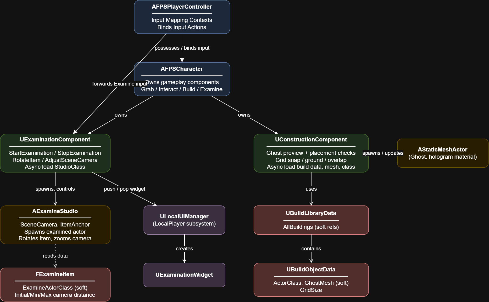
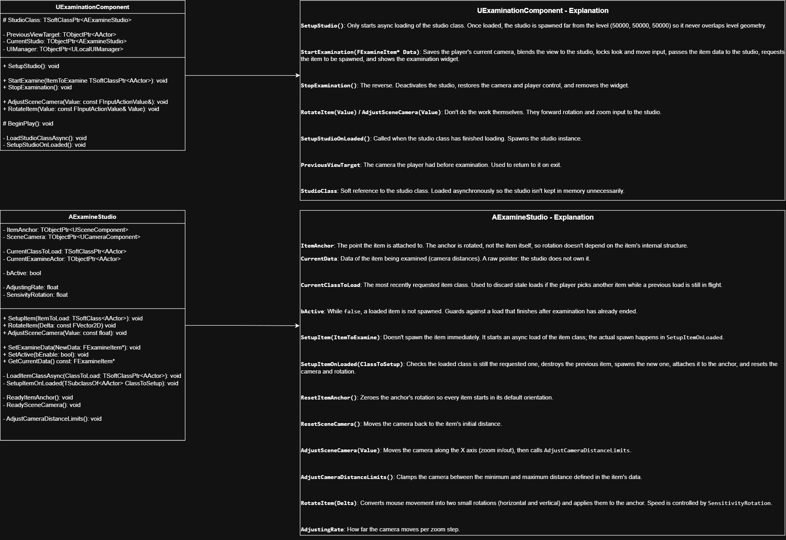
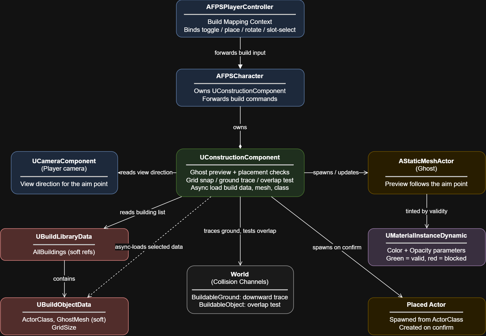
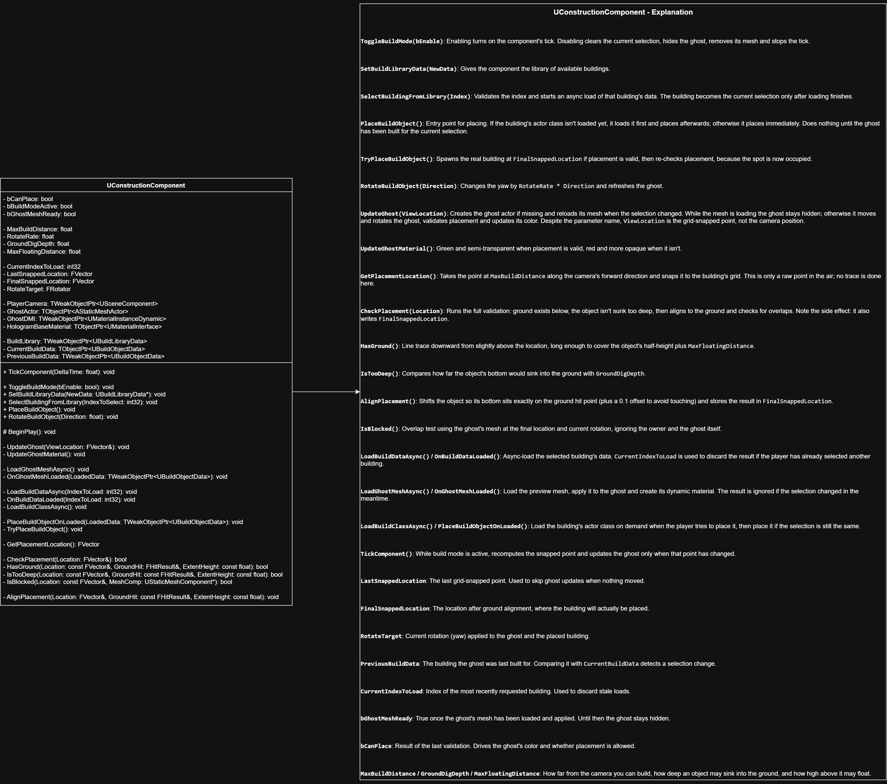

# <Project Name>

A first-person shooter prototype built solo in **Unreal Engine <5.x>** with **C++**, focused on gameplay systems and clean, data-driven architecture.

> Status: work in progress. Some older systems are still being refactored (see [Known issues](#known-issues)).

<!-- Drag your best 10-20 second clip here in GitHub's web editor. It uploads the file and inserts a link. -->

## Features

- **Object examination:** inspect items in a separate studio scene with smooth camera blending, rotation and zoom.
- **Construction:** ghost preview with grid snapping, ground checks and overlap validation, then placement.
- **Weapons:** weapon manager, attachments, view model. <!-- describe in 1-2 lines -->
- **Inventory:** item definitions and fragments. <!-- describe in 1-2 lines -->
- **UI:** menus, options, settings widgets. <!-- describe in 1-2 lines -->
- **Movement:** sprint and stamina components.

## Demo

### Examination

https://github.com/user-attachments/assets/5779bf79-846d-4a3f-bc3e-ad7fe40e5141

### Construction

https://github.com/user-attachments/assets/499b257f-7ace-45a5-bc55-0f8ae230cd61

## Architecture

The game is built from small components owned by the character. The player controller only translates input into calls, and gameplay classes never depend on UI classes directly.

Diagram sources (editable in [draw.io](https://app.diagrams.net/)) are in [`docs/diagrams`](docs/diagrams).

### Examination system

- `UExaminationComponent` handles the flow: remember the current camera, blend to the studio, lock look and move input, request the item and push the examination widget. Exiting reverses all of it.
- `AExamineStudio` is spawned far from the level (50000, 50000, 50000) so it never overlaps level geometry. It owns the camera and an anchor the examined item is attached to. Rotation is applied to the anchor, not to the item.
- Item data (`FExamineItem`) defines the item class (soft reference) and the initial, minimum and maximum camera distance.

### Construction system

1. Build mode adds a mapping context and enables the component's tick.
2. Selecting a building async-loads its data. Stale loads are discarded using the last requested index.
3. Every tick the aim point (camera forward at `MaxBuildDistance`) is snapped to the building's grid. The ghost updates only when the snapped point changes.
4. The ghost mesh is loaded asynchronously and the ghost stays hidden until it is ready.
5. Placement validation: a downward trace must find ground, the object must not sink deeper than `GroundDigDepth`, it is aligned to the ground, then an overlap test checks for blockers.
6. The ghost turns green when placement is valid and red when it is not.
7. Placing spawns the real actor (loading its class on demand if needed) and re-validates the spot.

## Technical highlights

- **Asynchronous loading** with soft references (`TSoftClassPtr`, `TSoftObjectPtr`, `FStreamableManager`), with guards against stale or late results (`CurrentIndexToLoad`, `CurrentClassToLoad`, `bActive`).
- **Data-driven design** with data assets for buildings and items instead of hard-coded values.
- **Enhanced Input** with separate mapping contexts for build and examination modes.
- **Component-based architecture:** each gameplay feature lives in its own component.
- **Custom collision channels** for buildable ground and buildable objects.

## Known issues

- Some older classes still use raw pointers and expose more than they should. I am converting them to `UPROPERTY` / smart pointers and tightening encapsulation, starting with the places that can crash.
- The saving system is unstable. <!-- say what exactly fails -->
- Several managers have overlapping responsibilities (`GameUIManager`, `UIManager`, `LocalUIManager`). <!-- delete if resolved -->

## Roadmap

- [ ] Finish the refactor of the older systems
- [ ] Make saving stable
- [ ] Playable demo build
- [ ] <!-- next planned feature -->

## Getting started

Requirements: Unreal Engine <5.x>, Visual Studio with the "Game development with C++" workload.

1. Clone the repository.
2. Right-click the `.uproject` file and choose **Generate Visual Studio project files**.
3. Open the generated `.sln`, build the `Development Editor` configuration for `Win64`, and open the project.

### Controls

| Action | Key |
|---|---|
| <!-- action --> | <!-- key --> |

## Assets

<!-- List third-party assets and their licenses. Do not publish paid marketplace assets in a public repository. -->

## Contact

<!-- GitHub / email / LinkedIn -->
