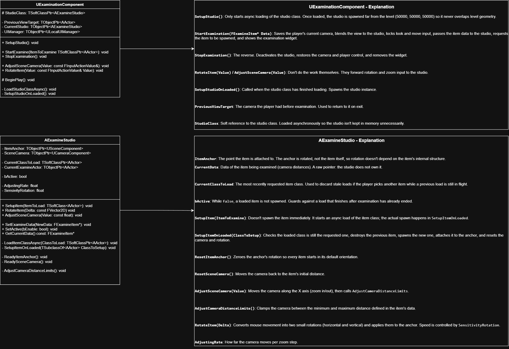

# FPS_Project

A first-person shooter prototype built solo in **Unreal Engine 5.0** with **C++**. The goal of the project is not the content but the code: component-based architecture, data-driven design, asynchronous loading and clean ownership of objects.

> **Status:** playable prototype, actively refactored. A lot of code was changed in one large pass (encapsulation, polymorphism, async loading, pooling, state handling). Some older places were not touched yet and may still contain raw pointers, public fields or leftover code. See [Known issues](#known-issues).

<!-- Drag your best 10-20 second clip here in GitHub's web editor. It uploads the file and inserts a link. -->

## Contents

- [Features](#features)
- [Demo](#demo)
- [Architecture](#architecture)
- [What changed in the refactor](#what-changed-in-the-refactor)
- [Weapons and animation-driven logic](#weapons-and-animation-driven-logic)
- [Systems](#systems)
- [Class diagrams](#class-diagrams)
- [Known issues](#known-issues)
- [Roadmap](#roadmap)
- [Getting started](#getting-started)

## Features

- **Weapons:** several guns (M4, M1911, Mossberg 590, BREN2, Honey Badger) on one polymorphic base class, attachments (sight, grip, stock, laser), recoil, spread, reload types (magazine and shell by shell), pooled shell casings.
- **First-person view model:** spring-based sway, jump and movement offsets, aiming down sights aligned to the sight's aim socket, left-hand IK with an animation curve weight.
- **Inventory:** slots, stacking, drop, items built from data assets and fragments.
- **Interaction:** tap to pick up, hold to grab a physics object, throw, examine items.
- **Object examination:** inspect an item in a separate studio scene with camera blending, rotation and zoom.
- **Construction:** ghost preview, grid snapping, ground and overlap checks, placement.
- **Movement:** sprint with stamina, crouch with a stand-up check, state-driven field of view.
- **UI:** widget stack subsystem (menus, inventory, options), data-driven and loaded asynchronously.

## Demo

<!-- Drag clips here in GitHub's web editor. Suggested: weapons + reload, inventory + pickup, examination, construction. -->

### Weapons and animation

<!-- drag weapons clip here -->

### Inventory and interaction

<!-- drag inventory clip here -->

### Examination

https://github.com/user-attachments/assets/5779bf79-846d-4a3f-bc3e-ad7fe40e5141

### Construction

https://github.com/user-attachments/assets/499b257f-7ace-45a5-bc55-0f8ae230cd61

## Architecture

The character is a **composition root**: it creates the components and wires them together with delegates. Each component owns one feature. The player controller only translates input into calls. Gameplay classes never depend on widgets; UI talks to gameplay through delegates and a context object.

```
AFPSPlayerController  (input only: Enhanced Input, mapping contexts)
        |  calls
        v
AFPSCharacter  (composition root, wires delegates in BeginPlay)
   |-- UFPSStateComponent        single source of truth for character state (FStateList)
   |-- UCrouchComponent / USprintComponent / UStaminaComponent
   |-- UFieldOfViewComponent     reacts to state changes
   |-- UWeaponManager            weapons, equip/holster/reload state machine
   |      '-- AWeaponBase (+ 5 weapons)  -- UWeaponAttachmentComponent, AWeapon_Casing pool
   |-- UViewModelComponent       arms, springs, ADS, montage playback, anim notify entry point
   |-- URecoilComponent
   |-- UInventoryComponent       slots, items, fragments
   |-- UInteractionComponent / UHandleGrabComponent
   |-- UExaminationComponent  -> AExamineStudio
   '-- UConstructionComponent

ULocalUIManager, ULocalGlobalSettings  (LocalPlayer subsystems)
UFPSAnimInstance                       (reads data through interfaces)
```

Communication rules:

- **Down:** owners call methods of the components they own.
- **Up and sideways:** components announce things with multicast delegates (`OnShoot`, `OnWeaponLoaded`, `OnStatesChanged`, `OnInventorySlotSelected`, ...). The character subscribes and connects the right listeners, so components do not know each other.
- **Across module borders:** interfaces (`IWeaponIKProvider`, `ICharacterStateProvider`, `IInteractableInterface`, `IExaminatableInterface`).

Signal flow of the whole game, as drawn in the diagrams:

1. Input &rarr; controller &rarr; component method (`TryShoot`, `ToggleCrouch`, `EndInteraction`, ...).
2. Component changes its own data and broadcasts a delegate.
3. The character wired the delegate to another component, which reacts.
4. Animation notifies report back to the code when something has happened in a montage (see below).

## What changed in the refactor

### Encapsulation
- Fields moved to `private`/`protected`; the outside world uses small getters and `Try*` methods that validate before they act (`TrySetWeaponState` returns `false` if the transition is not allowed).
- Pointers to other objects are `TWeakObjectPtr` when the object is not owned, `TObjectPtr` with `UPROPERTY` when it is. No raw `UObject*` members that the garbage collector cannot see.
- `Instanced` fragments and data assets keep data out of code.

### Polymorphism
- `AWeaponBase` defines the contract (`Shoot`, `Reload`, ammo, cooldown, spread); concrete weapons override what differs. `UWeaponManager` works only with the base class.
- Interfaces replace casts to concrete classes: the interaction component works with anything that implements `IInteractableInterface`; the AnimInstance reads IK and view-model state through `IWeaponIKProvider` and `ICharacterStateProvider`.
- Item behaviour is composed from `UItemFragment` objects (`FindFragment<T>`) instead of an inheritance tree of item types.

### Dynamic (asynchronous) loading
- Weapons, widgets, build data, ghost meshes and the examination studio are **soft references** (`TSoftClassPtr`, `TSoftObjectPtr`) loaded with `FStreamableManager::RequestAsyncLoad` only when needed.
- **Stale-load guards:** request ids (`PendingActivations`), `CurrentIndexToLoad`, `CurrentClassToLoad` and `bActive` discard results that arrive after the player has already moved on.
- Lambdas capture `TWeakObjectPtr` so a destroyed owner is never touched.
- Naming: `LoadXAsync` starts a load, `OnXLoaded` is the completion, `HandleXChanged` reacts to a delegate.
- Widgets flagged `bPreload` are loaded at start to avoid a hitch on first open; `bActivateOnLoaded` shows a widget as soon as it is ready.

### Architecture
- State is a single `FStateList` in `UFPSStateComponent`. Sprint, crouch, weapons, field of view and the animation blueprint read or react to it instead of keeping duplicated booleans.
- UI is a **LocalPlayer subsystem** with a widget stack, layers and one action delegate. Widgets receive a `Context` object, so neither side needs a hard dependency on the other.
- Everything tunable lives in data assets (`UWeaponData`, `UItemDefinition`, `UUIData`, `UBuildLibraryData`, `UBuildObjectData`, `UCharacterStatsDataAsset`).

### Optimization
- **Object pooling** for shell casings: spawned once, activated and returned instead of spawn/destroy per shot.
- **Tick on demand:** `UCrouchComponent`, `UFieldOfViewComponent`, `URecoilComponent`, `UViewModelComponent` and weapons enable their tick only while they have work and switch it off afterwards.
- **Events instead of polling:** state, ammo, stamina and inventory changes are broadcast only when a value really changed.
- Async loading keeps hitches out of the game thread; the ghost mesh and weapons never block the frame.

## Weapons and animation-driven logic

The weapon flow is driven by the animations, not by timers. A montage contains **AnimNotifies** that fire at an exact stage of the animation and tell the code what happened. The code then decides what to do next.

```
Montage frame reached
  -> UAnimNotify_*            (placed on the montage by the animator)
  -> UViewModelComponent      (entry point: HandleMontageFinished / HandleWeaponAnimEvent / HandleWeaponCasingEvent)
  -> OnMontageFinished        (delegate, wired by the character)
  -> UWeaponManager::HandleMontageFinished(EWeaponAnimStage)
  -> next action: charge, insert next shell, become Ready, activate the next weapon ...
```

| Notify | Fires at | What the code does next |
|---|---|---|
| `AnimNotify_WeaponAnimStage` (`EWeaponAnimStage`) | end of a stage (shoot, reload start/end, charge, insert ammo, stock) | `UWeaponManager` advances its state machine |
| `AnimNotify_HolsterFinished` | end of holster | previous weapon is hidden, the pending weapon is activated and its equip montage starts |
| `AnimNotify_EquipFinished` | end of equip | state becomes `Ready`, the weapon can shoot |
| `AnimNotify_WeaponEvent` (`EWeaponAnimEvent`) | a frame inside a montage (mag out, mag in, clatch, charge back, ...) | weapon plays the matching sound at that frame |
| `AnimNotify_SpawnCasing` | the frame where the shell leaves the weapon | a casing is taken from the pool and ejected |

Example, shell-by-shell reload: `Reload_Start` montage &rarr; `ReloadStartFinished` &rarr; manager checks the magazine and plays `InsertAmmo` &rarr; `InsertAmmoFinished` adds one round and repeats until the magazine is full or reserve ammo ends &rarr; `Reload_Finish` &rarr; charge if needed &rarr; `Ready`.

Because logic follows the animation, changing the length of a montage does not break the code.



## Systems

### Examination
- `UExaminationComponent` remembers the current view target, blends to the studio, locks look/move input, requests the item and pushes the widget. Exiting reverses everything.
- `AExamineStudio` is spawned far from the level so it never overlaps level geometry. It owns the camera and an anchor; rotation is applied to the anchor, not to the item.
- Item data (`FExamineItem`) defines the item class (soft reference) and the camera distances.


### Construction
1. Build mode adds a mapping context and enables the component's tick.
2. Selecting a building async-loads its data; stale loads are discarded by `CurrentIndexToLoad`.
3. Every tick the aim point is snapped to the building's grid; the ghost updates only when the snapped point changes.
4. The ghost mesh loads asynchronously and stays hidden until ready.
5. Validation: ground trace, depth limit, alignment, overlap test.
6. Ghost is green when placement is valid, red when not.
7. Placing spawns the real actor (loading its class on demand) and re-validates the spot.


## Class diagrams

Every important class has two diagrams in [`docs/diagrams`](docs/diagrams) (editable in [draw.io](https://app.diagrams.net/)):

- `<class>_system` - everything inside the class: fields, methods and an explanation of each.
- `<class>_behavior` - how the class is connected to other classes: who drives it and what it drives.

| Area | Class | Contents | Relations |
|---|---|---|---|
| Core | `AFPSCharacter` | [system](docs/diagrams/fps_character_system.drawio) | [behavior](docs/diagrams/fps_character_behavior.drawio) |
| Core | `AFPSPlayerController` | [system](docs/diagrams/fps_player_controller_system.drawio) | [behavior](docs/diagrams/fps_player_controller_behavior.drawio) |
| State and movement | `UFPSStateComponent` | [system](docs/diagrams/fps_state_component_system.drawio) | [behavior](docs/diagrams/fps_state_component_behavior.drawio) |
| State and movement | `UCrouchComponent` | [system](docs/diagrams/crouch_component_system.drawio) | [behavior](docs/diagrams/crouch_component_behavior.drawio) |
| State and movement | `USprintComponent` | [system](docs/diagrams/sprint_component_system.drawio) | [behavior](docs/diagrams/sprint_component_behavior.drawio) |
| State and movement | `UStaminaComponent` | [system](docs/diagrams/stamina_component_system.drawio) | [behavior](docs/diagrams/stamina_component_behavior.drawio) |
| State and movement | `UFieldOfViewComponent` | [system](docs/diagrams/field_of_view_component_system.drawio) | [behavior](docs/diagrams/field_of_view_component_behavior.drawio) |
| Weapons | `UWeaponManager` | [system](docs/diagrams/weapon_manager_system.drawio) | [behavior](docs/diagrams/weapon_manager_behavior.drawio) |
| Weapons | `AWeaponBase` | [system](docs/diagrams/weapon_base_system.drawio) | [behavior](docs/diagrams/weapon_base_behavior.drawio) |
| Weapons | `AWeapon_Casing` | [system](docs/diagrams/weapon_casing_system.drawio) | [behavior](docs/diagrams/weapon_casing_behavior.drawio) |
| Weapons | `UWeaponAttachmentComponent` | [system](docs/diagrams/weapon_attachment_component_system.drawio) | [behavior](docs/diagrams/weapon_attachment_component_behavior.drawio) |
| Weapons | `URecoilComponent` | [system](docs/diagrams/recoil_component_system.drawio) | [behavior](docs/diagrams/recoil_component_behavior.drawio) |
| View and animation | `UViewModelComponent` | [system](docs/diagrams/view_model_component_system.drawio) | [behavior](docs/diagrams/view_model_component_behavior.drawio) |
| View and animation | `UFPSAnimInstance` | [system](docs/diagrams/fps_anim_instance_system.drawio) | [behavior](docs/diagrams/fps_anim_instance_behavior.drawio) |
| View and animation | AnimNotifies | [system](docs/diagrams/anim_notifies_system.drawio) | [behavior](docs/diagrams/anim_notifies_behavior.drawio) |
| Items | `UInventoryComponent` | [system](docs/diagrams/inventory_component_system.drawio) | [behavior](docs/diagrams/inventory_component_behavior.drawio) |
| Items | `APickUpActor` | [system](docs/diagrams/pick_up_actor_system.drawio) | [behavior](docs/diagrams/pick_up_actor_behavior.drawio) |
| Interaction | `UInteractionComponent` | [system](docs/diagrams/interaction_component_system.drawio) | [behavior](docs/diagrams/interaction_component_behavior.drawio) |
| Interaction | `UHandleGrabComponent` | [system](docs/diagrams/handle_grab_component_system.drawio) | [behavior](docs/diagrams/handle_grab_component_behavior.drawio) |
| Interaction | `UExaminationComponent` | [system](docs/diagrams/examination_component_system.drawio) | [behavior](docs/diagrams/examination_component_behavior.drawio) |
| Interaction | `AExamineStudio` | [system](docs/diagrams/examine_studio_system.drawio) | [behavior](docs/diagrams/examine_studio_behavior.drawio) |
| Building | `UConstructionComponent` | [system](docs/diagrams/construction_component_system.drawio) | [behavior](docs/diagrams/construction_component_behavior.drawio) |
| UI and settings | `ULocalUIManager` | [system](docs/diagrams/local_ui_manager_system.drawio) | [behavior](docs/diagrams/local_ui_manager_behavior.drawio) |
| UI and settings | `ULocalGlobalSettings` | [system](docs/diagrams/local_global_settings_system.drawio) | [behavior](docs/diagrams/local_global_settings_behavior.drawio) |

## Known issues

This project went through a large refactor in a short time. I list what I know is still open:

- Not every class was refactored. Some older files may still expose fields or use raw pointers.
- `URecoilComponent` accumulates the applied offset instead of replacing it; recovery needs a fix.
- `UCrouchComponent`: the stand-up check uses the current capsule shape and a fixed height threshold.
- `UWeaponManager` still contains leftovers (old `WeaponClasses` list, `WeaponsArr` vs slot index mapping, repeated null checks).
- The saving system (`FPSGlobalSettingsSave`) is unstable.
- Several UI managers have overlapping responsibilities (`GameUIManager`, `UIManager`, `LocalUIManager`).
- Debug draw calls (`DrawDebugLine`, `DrawDebugSphere`) are still in `UInteractionComponent` and `AWeaponBase`.
- No multiplayer: nothing is replicated.

## Roadmap

- [ ] Finish the refactor of the remaining classes
- [ ] Fix recoil recovery and crouch checks
- [ ] Make saving stable
- [ ] Clean up the UI manager overlap
- [ ] Playable demo build

## Getting started

Requirements: Unreal Engine 5.0, Visual Studio with the "Game development with C++" workload.

1. Clone the repository.
2. Right-click `FPS_Project.uproject` and choose **Generate Visual Studio project files**.
3. Open the generated `.sln`, build `Development Editor` for `Win64`, and open the project.

> The `Content/` folder is not in the repository (it is ignored), so the project opens with C++ only. Assets are listed below.

### Controls

| Action | Key |
|---|---|
| <!-- action --> | <!-- key --> |

## Assets

<!-- List third-party assets and their licenses. Do not publish paid marketplace assets in a public repository. -->

## Contact

<!-- GitHub / email / LinkedIn -->
